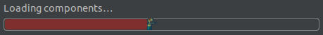

# ZombieProgressBar

## Preview

My take on a lovely zombie progress bar for IntelliJ and IntelliJ based IDEs.  

**Compatibility:** IntelliJ IDEA and other JetBrains IDEs 2025.2 and later. For older IDEs, the Marketplace offers version 1.1.2.

## Installation

Get it via the Jetbrains Marketplace: https://plugins.jetbrains.com/plugin/30702-zombieprogressbar

### Build Locally Using Docker + just (no local Java/Gradle)
**Requirements:**
- [docker compose](https://docs.docker.com/compose/)
- [just](https://github.com/casey/just)

- **Build plugin:** `just build`
- the Plugin .zip is available at build/distributions
- open your Jetbrains IDE: settings -> Plugins -> Cog -> Install  from Disk -> select the .zip Folder -> restart IDE
- **Try it in a sandbox IDE:** `just run-ide` (needs an X11 or Xwayland display). Only this repository is available inside the container, at `/workspace`, so open projects from there
- **Check compatibility:** `just verify` runs the IntelliJ Plugin Verifier against all supported IDE releases
- **Publish:** `just publish` (requires `PUBLISH_TOKEN` and the signing environment variables)

The build creates two local cache folders in the project root, both safe to delete and ignored by Git:
- `.gradle-docker/`: the Gradle home used inside Docker, incl. downloaded IDEs, so they are not downloaded again on every build
- `.intellijPlatform/`: local files of the IntelliJ Platform Gradle Plugin, incl. the sandbox IDE's config, plugins and logs

## Contributions
Contributions are very welcome on this project! Contributions can take the form of bug reports, feature requests, zombie/survivor requests or more!

## Acknowledgements
Inspired by: 
- [Law Millenium](https://github.com/law-millenium)'s great [Naruto Progress Bar](https://github.com/law-millenium/naruto-progress)
- [Nyan Cat Plugin](https://github.com/batya239/NyanProgressBar) by Dmitry Batkovich.
